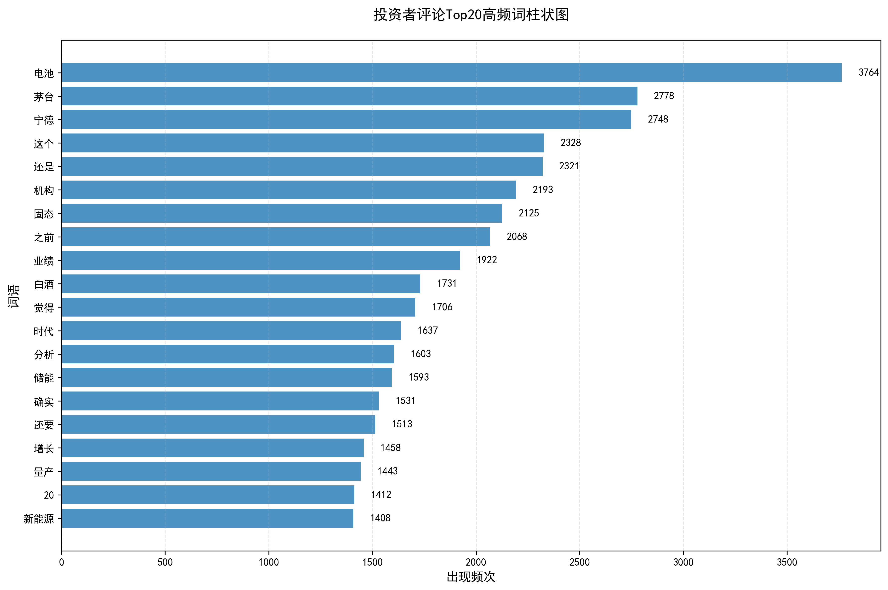
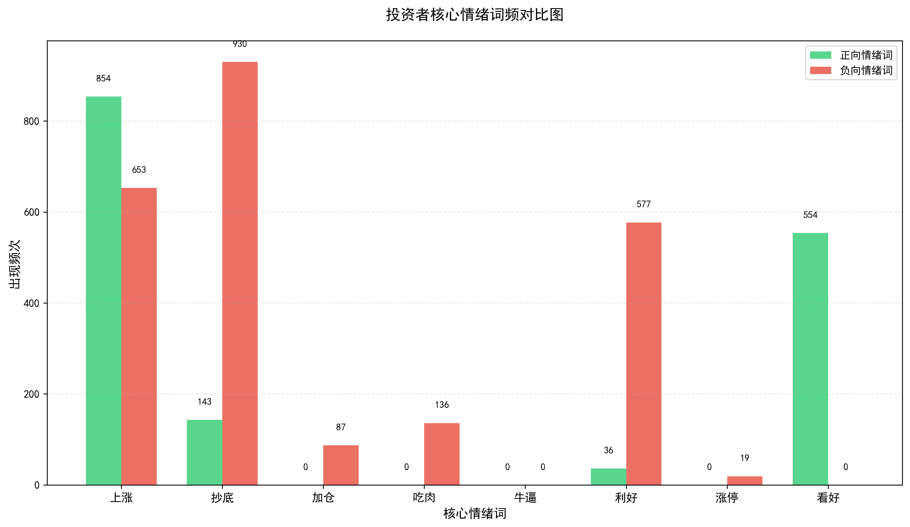
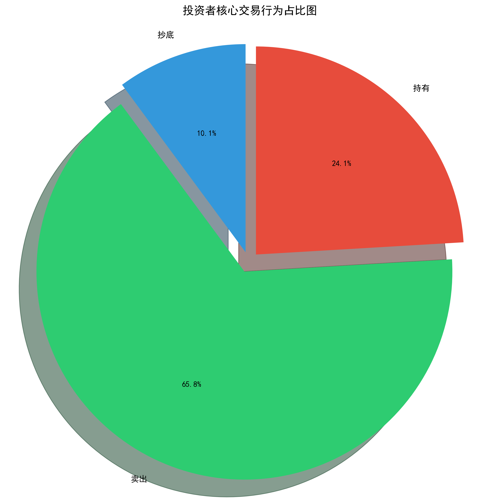
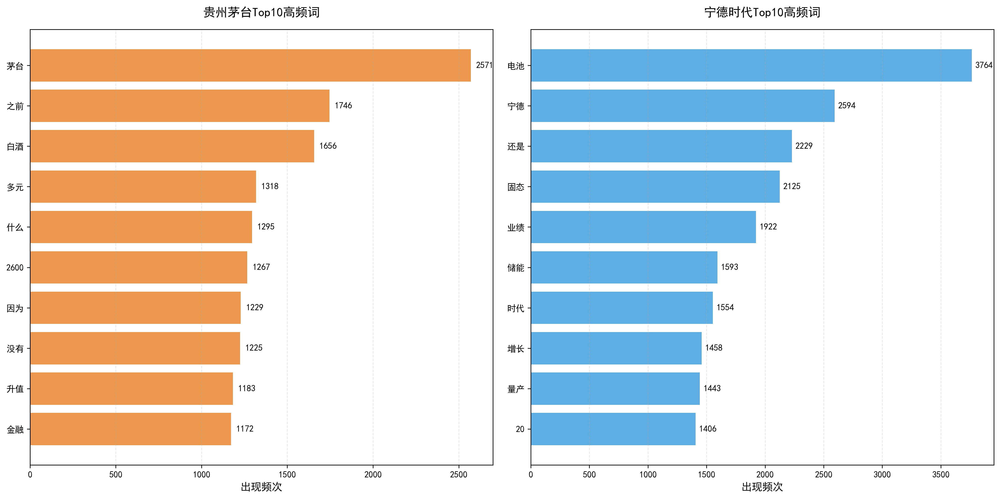
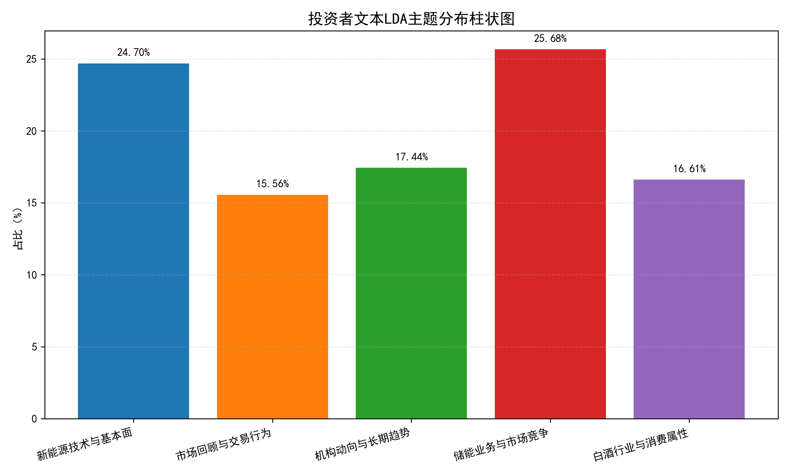
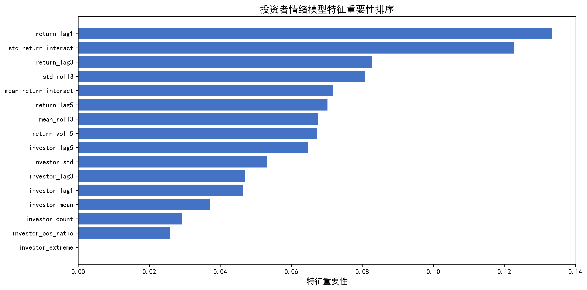
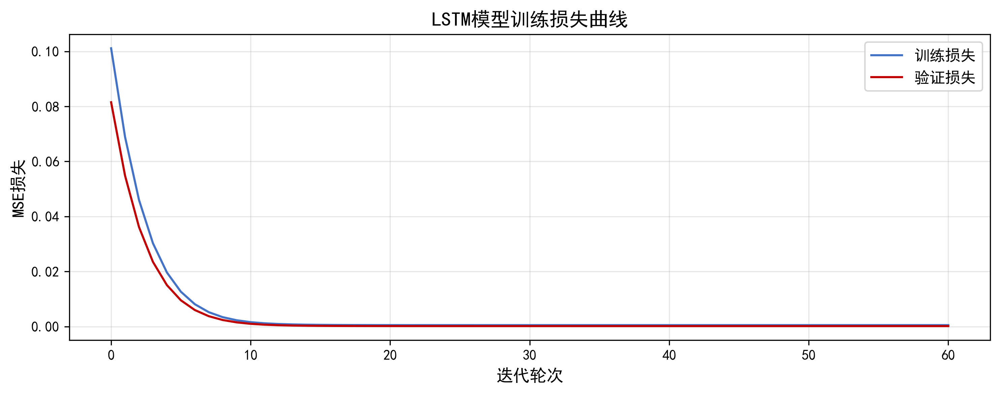
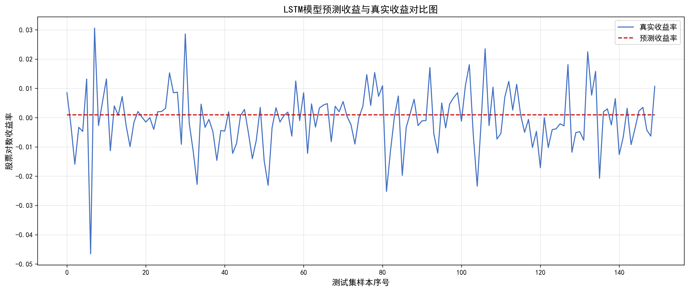
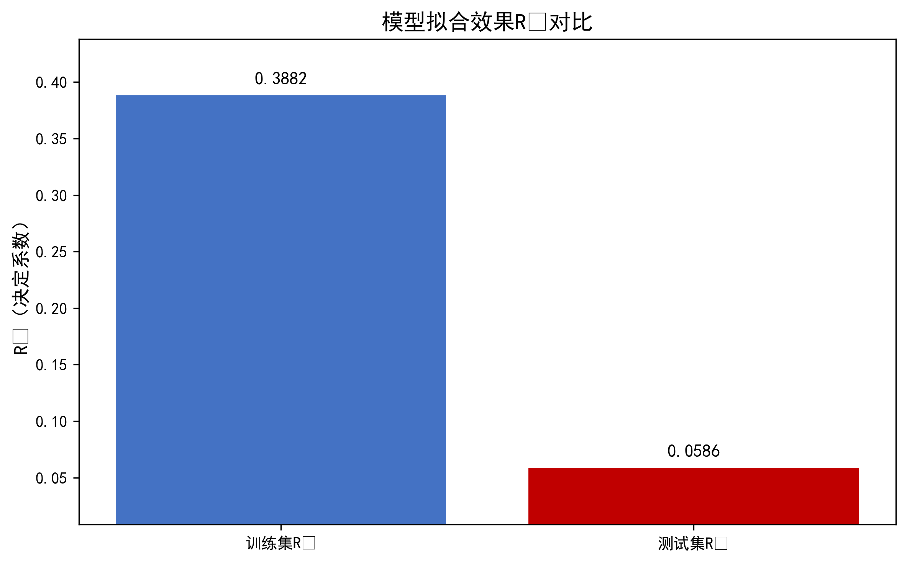
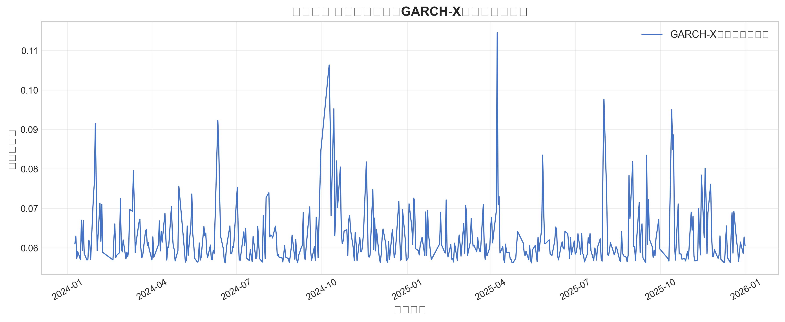

# 股吧投资者情绪分析与股价预测

> 从东方财富股吧文本出发，构建「文本 → 情绪指标 → 股价预测」的完整分析链路：中文分词、情感量化、LDA 主题建模、特征工程，最后用随机森林 / LSTM / GARCH-X 三类模型验证情绪因子对收益与波动的解释力。
> 本项目为《财经领域数据挖掘与分析》综合实践作品。

## 研究问题

行为金融学认为投资者情绪会驱动交易行为，进而影响股价。本项目要回答三个问题：

1. 股吧文本里的情绪能否被稳定量化成日度指标？
2. 情绪指标对次日的收益率/波动率有没有解释力？
3. 不同个股（贵州茅台、宁德时代等）的情绪分歧度是否不同？

## 分析链路

```
股吧原始文本
   │  01 数据清洗 → 02 去重 → 03 分词
   ▼
分词后的评论语料
   │  04 情感打分（情绪词典 + 交易行为词）
   ▼
评论级情绪 + 日度投资者情绪指标
   │  05/06 词云、词频、个股对比等文本分析
   ▼
投资者情绪特征表（均值、分歧度、熵、交易活跃度等）
   │  07 特征工程
   ▼
   ├── 08 随机森林回归：情绪因子 → 收益率
   ├── 09 LSTM 时序预测
   └── 10 GARCH-X：情绪因子 → 波动率
      11 LDA 主题建模：提取主题与情绪分歧
```

## 主要结果

| 高频词分布 | 情绪词频对比 |
|---|---|
|  |  |

| 交易行为占比 | 个股 Top10 高频词 |
|---|---|
|  |  |

| LDA 主题分布 | 情绪特征重要性 |
|---|---|
|  |  |

| LSTM 训练损失 | LSTM 预测对比 |
|---|---|
|  |  |

| 随机森林 R² 对比 | GARCH-X 拟合波动率（宁德时代） |
|---|---|
|  |  |

## 目录结构

```
stock-sentiment-analysis/
├── scripts/
│   ├── 01_data_cleaning.py       # 原始股吧文本清洗
│   ├── 02_dedup.py               # 重复评论去重
│   ├── 03_tokenize.py            # 中文分词与停用词过滤
│   ├── 04_sentiment_scoring.py   # 情感打分，生成日度情绪指标
│   ├── 05_text_analysis_v1.py    # 文本分析（初版：词频、词云）
│   ├── 06_text_analysis_v2.py    # 文本分析（完整版：分个股对比、情绪词分析）
│   ├── 07_feature_engineering.py # 情绪特征工程，生成最终特征表
│   ├── 08_random_forest.py       # 随机森林回归
│   ├── 09_lstm.py                # LSTM 时序预测
│   ├── 10_garch_x.py             # GARCH-X 波动率建模
│   └── 11_lda_topic.py           # LDA 主题建模与情绪分歧提取
├── docs/images/                  # 分析产出图表
├── data/                         # 数据占位（不含原始数据）
├── requirements.txt
└── README.md
```

## 运行方式

**1. 安装依赖**

```bash
pip install -r requirements.txt
```

**2. 准备数据**

放入 `data/` 目录（见 [data/README.md](data/README.md)）：

- `investor_sentiment_data .csv` —— 股吧原始评论（注意文件名中有一个空格，脚本按原名读取）
- `public_stock_market_data_final.csv` —— 个股日行情数据

**3. 按顺序执行**

```bash
cd scripts
python 01_data_cleaning.py
python 02_dedup.py
python 03_tokenize.py
python 04_sentiment_scoring.py
python 06_text_analysis_v2.py
python 07_feature_engineering.py
python 08_random_forest.py
python 09_lstm.py
python 10_garch_x.py
python 11_lda_topic.py
```

## 说明与局限

- 脚本中的词云字体写死为 `C:/Windows/Fonts/simhei.ttf`，macOS / Linux 需改为对应中文字体路径。
- 数据为课程实践采集的股吧样本与行情数据，**未随仓库分发**；中间结果 CSV 也不提交。
- 情感词典由人工整理，覆盖范围有限，属于课程阶段方案，生产环境应替换为金融领域预训练模型。
- 各脚本的参数（窗口长度、LDA 主题数、树的数量）在代码中硬编码，未做网格搜索。

## 环境

Python 3.9+。依赖：pandas / numpy / jieba / scikit-learn / tensorflow（或 keras）/ arch / gensim / matplotlib / wordcloud / seaborn。
